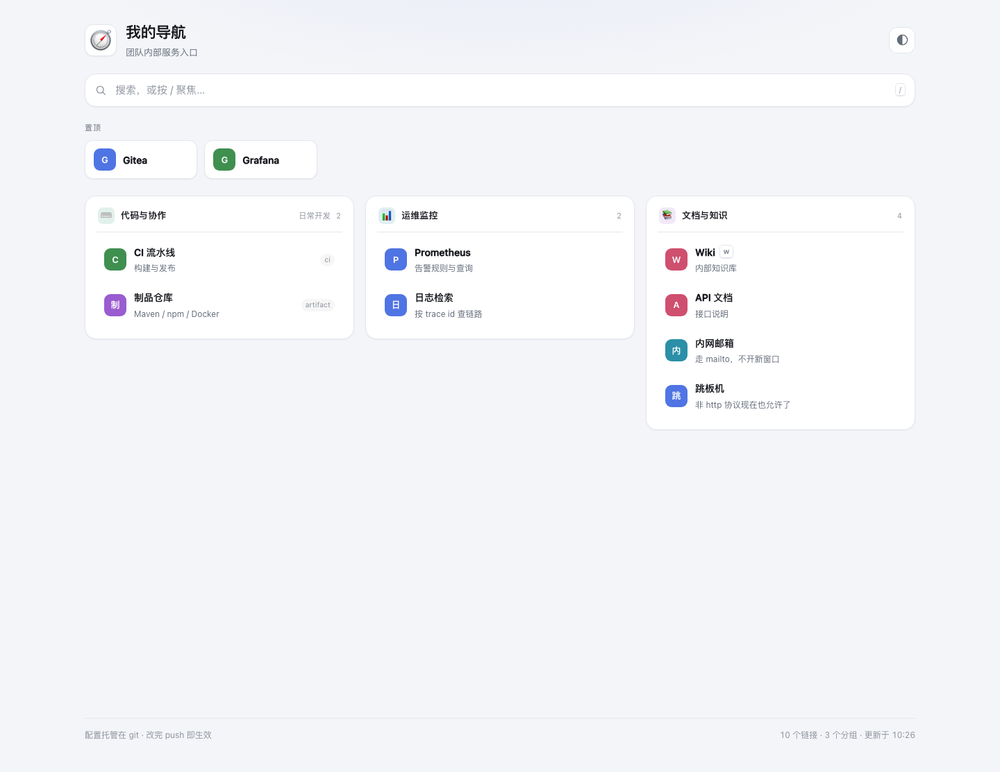
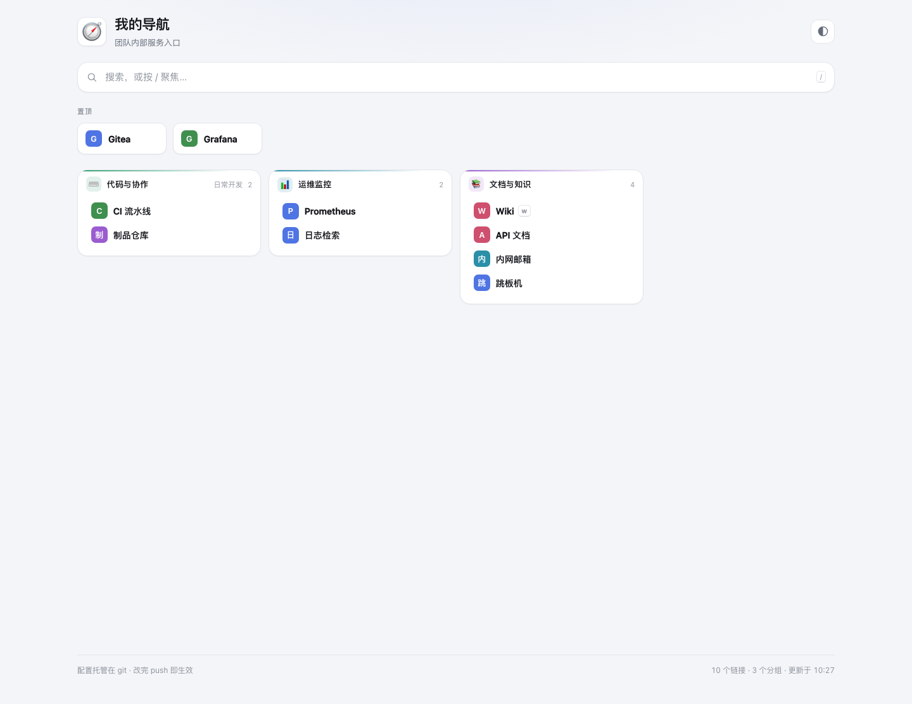
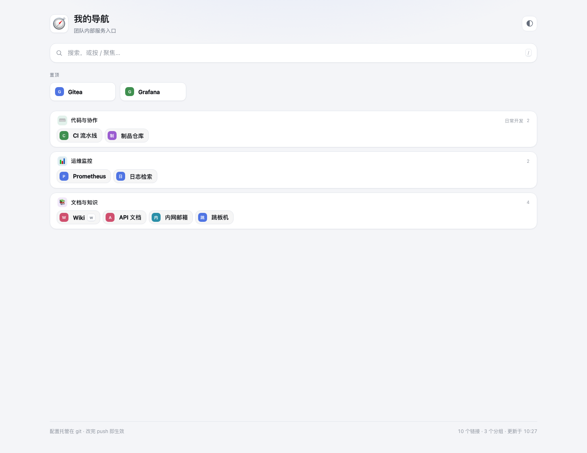

# ghome

配置托管在 git 里的导航页。**改 `nav.yaml` → `git push` → 页面自己变**，不用重新部署、不用重新构建。

- **配置就是 git 仓库里的一个 YAML 文件**，历史、diff、review、回滚全部白送。
- **改样式也不用重新编译**：颜色、圆角、字号、密度是 `nav.yaml` 里的令牌，想大改就放一个 `custom.css` 进仓库——两者都走同一条 push 即生效的链路。真要动 DOM 结构，`--dump-web` 导出前端再 `--web-dir` 指过去。
- **三套布局**：`grid` 精致卡片 / `dashboard` 紧凑密集 / `list` 单列。
- **私有仓可用**：Gitea 的 token 只存在服务端，浏览器拿不到。
- **图标由服务端解析并缓存**（解析 `<link rel="icon">`），所以哈希命名的图标、没有 `favicon.ico` 的内网站点、以及不联网的浏览器都能显示图标。
- **可选的服务状态灯**（默认关闭，关着时零探测流量）：绿/红点 + 右上角"2/3 在线"，点它只看异常。
- **单二进制，零运行时依赖**：静态编译的 Go，空载内存 13 MB。
- **推错配置不会把页面搞挂**：结构性问题整份拒绝，继续服务上一版好配置；外观性问题只记 warning 并在页面上提示。

---

## 目录

- [30 秒跑起来](#30-秒跑起来)
- [三套布局](#三套布局)
- [改样式不用重新编译](#改样式不用重新编译)
- [接你的私有 Gitea / Forgejo](#接你的私有-gitea--forgejo)
- [一次 push 是怎么走到浏览器的](#一次-push-是怎么走到浏览器的)
- [图标是怎么来的](#图标是怎么来的)
- [服务状态灯](#服务状态灯)
- [nav.yaml 配置](#navyaml-配置)
- [校验分级](#校验分级)
- [部署](#部署)
- [命令行与环境变量](#命令行与环境变量)
- [HTTP 接口](#http-接口)
- [排障](#排障)
- [设计上的几个取舍](#设计上的几个取舍)
- [开发](#开发)

---

## 30 秒跑起来

本地用文件模式，不需要 Gitea 就能看到效果：

```bash
make build
./bin/ghome --source=file --file=./nav.yaml
# 打开 http://127.0.0.1:8080/
```

现在编辑 `nav.yaml` 存盘，**页面会在 1 秒内自己更新，不需要刷新**（`--poll` 默认 60s，本地演示可以加 `--poll=1s`）。

想先看全部可用字段，读 [`nav.example.yaml`](nav.example.yaml)。

---

## 三套布局

在 `nav.yaml` 里改一行，push 就换：

```yaml
layout: grid        # 精致卡片（默认）：每组一张卡，描述和标签都显示
layout: dashboard   # 紧凑密集：行高更小、分组带色条、隐藏描述，服务多时用
layout: list        # 单列：每组一行，链接横向排成芯片，最省纵向空间
```

三套布局共用同一份内容，只是密度和呈现方式不同：

**grid**（默认）——每组一张卡，描述和标签都显示：



**dashboard**——紧凑密集，分组带顶部色条，服务多时用：



**list**——每组一行，链接横向排成芯片，最省纵向空间：



| | grid | dashboard | list |
| --- | --- | --- | --- |
| 卡片列宽 | ≥320px | ≥262px | 单列 |
| 链接描述 | 显示 | 隐藏 | 隐藏 |
| 分组色条 | 图标底 + 悬停描边 | 顶部渐变条 | 图标底 |
| 适合 | 十几到几十个入口 | 上百个入口 | 每组的链接都很短 |

不管你选哪套，页面上的能力都一样：搜索过滤、`↑`/`↓` 选择、`Enter` 打开、每个链接的 `hotkey`、置顶区、状态灯、分组配色。

**置顶**：`pinned: true` 的链接会被提升到页面顶部的置顶区，**并且不再出现在它所属的分组里**（避免同一个入口出现两次）。如果某个分组因此变空，该分组会被隐藏。

**分组配色**：给分组一个 `color`，它的图标底和卡片悬停描边就会带上这个色；dashboard 布局下还会变成顶部色条。

---

## 改样式不用重新编译

这是刻意设计的：**样式是数据，不是代码**。分四层，按你需要改的深度选。

### 第 1 层：`nav.yaml` 里的 `style:` 令牌（覆盖 90% 的需求）

```yaml
style:
  accent: "#7c3aed"       # 主色
  background: "#faf9ff"   # 页面底色
  surface: "#ffffff"      # 卡片底色
  text: "#1a1a1f"
  muted: "#6b6b78"
  border: "#e8e6f0"
  font: "Inter, system-ui, sans-serif"
  radius: 20              # 圆角
  fontSize: 15            # 正文字号
  width: 1280             # 内容最大宽度
  iconSize: 22            # 图标尺寸
  density: compact        # comfortable | compact
  cardStyle: strong       # soft | flat | strong
```

这些令牌由 `/theme.css` 以 CSS 变量发给浏览器，页面所有颜色、间距、圆角都从它们派生（渐变和悬停色用 `color-mix()` 算出来），所以改一个 `accent` 整页都跟着变。

**改完 push 就生效**，包括已经开着的页面——浏览器收到 SSE 事件后会带着新版本号重新拉 `theme.css`。

写错了不会让页面挂掉：颜色只接受 `#hex` / `rgb()` / `hsl()` / 颜色关键字，字号必须在 `11~24`，越界的值会被忽略并在页面顶部提示。这条限制是有意的——`style` 的值会直接进 CSS，不校验就等于开了一个注入点。

### 第 2 层：`custom.css`（想写具体规则时）

在**同一个仓库**里放一个样式表，然后指过去：

```yaml
style:
  customCss: "custom.css"
```

它的内容会被追加到 `/theme.css` 后面，也就是内嵌样式表和所有令牌**之后**，所以天然优先级更高。改它同样只需要 push。

**只改 `custom.css`、不动 `nav.yaml` 也能热更新**，这一点值得说明，因为它踩了一个坑：`nav.yaml` 的 blob SHA 在这种情况下不会变，如果浏览器拿它当"要不要重新拉样式表"的依据，页面就会一直显示旧样式直到有人手动刷新。所以 `/api/nav` 的 `meta` 里有两个 revision：

| 字段 | 是什么 | 变了代表 |
| --- | --- | --- |
| `revision` | `nav.yaml` 的 git blob SHA | 配置内容变了 |
| `themeRevision` | 覆盖**两份文件**的短哈希 | 配置**或**样式表变了 |

浏览器用 `themeRevision` 决定要不要重新拉 `/theme.css`（它同时是 cache buster），用 `revision` 决定要不要重绘整个页面。两者由服务端在同一个原子操作里发布，所以不存在"样式更新了但配置还是旧的"这种中间态。

`/healthz` 里两个值都能看到，出问题时直接在终端确认。

起点见 [`custom.css.example`](custom.css.example)，里面列了所有可用变量。适合：内嵌样式表没暴露成令牌的细节、给某个分组单独开小灶、加一层纯 CSS 装饰。

### 第 3 层：`--dump-web` + `--web-dir`（要动 DOM 结构或基础样式表时）

```bash
ghome --dump-web=/srv/ghome/web          # 把内嵌前端导出来
vim /srv/ghome/web/assets/style.css      # 随便改
ghome --web-dir=/srv/ghome/web ...       # 指过去
```

**逐文件回退**：`--web-dir` 里有就用磁盘上的，没有就用内嵌的。所以你只需要放想改的那一个文件——上面导出的目录里删掉 `app.js`，`app.js` 就继续跟着二进制走；升级 ghome 时没被覆盖的文件自动跟着更新。

`--dump-web` 的意思是"给我一份能跑的当前版本当起点"，不用你凭空建目录、猜文件名。

### 第 4 层：改 Go 代码

只有要加全新视图或新交互时才需要。到这一层 `internal/server/web/` 下的文件就是源码。

**样式为什么当初要内嵌？** 因为单文件部署意味着不存在"CSS 和二进制版本对不上"、"文件缺失"、"权限不对"、"只传了一半"这类故障，也不存在升级时忘记替换某个资源。这个价值我不想丢——所以做法是**保留内嵌作为默认，把可改的部分变成数据**，而不是把前端拆出去。

---

## 接你的私有 Gitea / Forgejo

### 1. 建一个配置仓和 token

建议**单独建一个仓**（例如 `your-name/nav`）只放导航配置和 `custom.css`，跟代码仓解耦，这样改导航的人不需要代码权限。

然后建 token：**头像 → 设置 → 应用（Applications）→ 生成令牌**，权限只需要**只读的仓库权限**（`read:repository`；拿不准就勾 `repo`，ghome 只会读）。Gitea 和 Forgejo 的界面路径一样。

> 为什么不用 `git clone`：一次 HTTP GET 就能拿到文件，不需要 git 二进制、不需要占磁盘的裸库，小机器上更省。

### 2. 跑起来

```bash
export GHOME_FORGE_TOKEN=你的token

./bin/ghome \
  --source=forgejo \          # 用 Gitea 就写 gitea，两者走同一套代码
  --forge-url=https://git.example.com \
  --forge-owner=your-name \
  --forge-repo=homepage \
  --forge-ref=main \
  --webhook-secret=$(openssl rand -hex 32)
```

`curl localhost:8080/healthz` 看到 `"status":"ok"` 就成了。

### 3. 配 webhook（"秒级"的来源）

仓库页 → **设置（Settings）→ Webhooks（网页钩子）→ 添加 Webhook**，类型按你跑的产品选：

| | Gitea | Forgejo |
| --- | --- | --- |
| 类型选 | `Gitea` | `Forgejo` |
| 界面路径 | 设置 → 网页钩子 | 设置 → Webhooks |

其余字段两个产品完全一样：

| 字段 | 填什么 |
| --- | --- |
| 目标 URL | `https://nav.example.com/api/webhook` |
| HTTP 方法 | `POST` |
| POST 内容类型 | `application/json` |
| 密钥（Secret） | **跟 `--webhook-secret` 完全一致的那个字符串** |
| 触发条件 | 勾 **推送事件（Push Events）** |
| 激活 | 勾上 |

保存后点 **Test Delivery**（Gitea 叫"测试推送"），ghome 回 `pong`——在"最近投递"里看到 **200** 就说明通了。

> **不确定自己的实例是哪个？** `curl https://你的域名/api/forgejo/v1/version` 返回 200 就是 Forgejo。
> 注意 Forgejo 的 `/api/v1/version` 会报成 `16.0.5+gitea-1.22.0` 这种样子——`+gitea-` 后面是它兼容的 **Gitea API 版本**，不是产品版本，别看错。

> **密钥必须填。** 没配 `--webhook-secret` 时 `/api/webhook` 直接返回 403 不工作，而不是无鉴权地裸奔。

签名校验接受这几个头中的**任意一个**匹配即可（都是对原始请求体做 HMAC）：

| 头 | 谁发 |
| --- | --- |
| `X-Gitea-Signature` | Gitea；较老的 Forgejo 也只发这个 |
| `X-Forgejo-Signature` | Forgejo（官方文档里用的就是这个） |
| `X-Hub-Signature-256` | GitHub 风格，`sha256=` 前缀 |
| `X-Hub-Signature` | GitHub 风格，`sha1=` 前缀 |

事件头同理，`X-Forgejo-Event` / `X-Gitea-Event` / `X-GitHub-Event` 依次识别。

### Forgejo 与 Gitea 的差别

Forgejo 是 Gitea 的 fork，**配置方式几乎一样**，只有两处要留意：

1. **签名头。** 较老的 Forgejo 源码里只 `Add` 了 `X-Gitea-Signature`；官方文档展示的是 `X-Forgejo-Signature`；事件头则是 `X-Forgejo-Event` 与 `X-Gitea-Event` 并列发出。所以 ghome 这几类头**任意一个匹配即通过**，你不用关心自己那版发哪个。
2. **flag 用中性的 `--forge-*`。** `--forge-url` / `--forge-owner` / `--forge-repo` / `--forge-token` 对两个产品一样用（API 路径完全兼容）。`--source` 写 `forgejo` 会让 `/healthz` 和日志显示 `forgejo:...`，写 `gitea` 就显示 `gitea:...`，那只是给诊断信息用的标签，不影响行为。

### 4. 验证

```bash
# 改一行 nav.yaml 或 custom.css 然后 push，页面上应该 1~2 秒内出现变化
git commit -am "改个标题" && git push
```

---

## 一次 push 是怎么走到浏览器的

```text
   你 git push
        │
        ▼
   Gitea ──webhook(HMAC 签名)──▶ POST /api/webhook
        │                              │  校验签名 + 校验分支
        │                              ▼
        │                        防抖 1.2s（一次 push 可能触发多个钩子）
        │                              │
        │                              ▼
        │                        GET /api/v1/repos/.../contents/nav.yaml
        │                        GET /api/v1/repos/.../contents/custom.css
        │                              │  都带上 token，只有服务端看得到
        │                              ▼
        │                        解析 + 校验整份 YAML
        │                          ├─ 通过 → 换上新配置，广播 SSE
        │                          └─ 不通过 → 保持旧配置，/healthz 标 degraded
        │                       两份文件的修订号合成 themeRevision
        │                              │
        ▼                              ▼
   60s 轮询兜底 ─────────────▶   GET /api/events  (浏览器长连接)
                                       │  事件只有一种："变了，重新读"
                                       ▼
                        重新拉 /api/nav + /api/status + theme.css
                                     │
                                     ▼
                          版本号变了才重绘 + "导航已更新" 提示
```

两条链路是**互补**的：webhook 快但可能丢（Gitea 重启、网络抖动、你忘了配），轮询慢但一定会到。任何一条通了，页面就不会停在旧版本。

事件类型只有一种（"变了"），浏览器收到后重新拉取并按版本号决定要不要重绘。这样即使通知被合并或丢弃，也不会出现"配置更新了但状态灯没更新"这种半新半旧的状态。

浏览器侧也有两条独立的路：

| | 方向 | 何时用 |
| --- | --- | --- |
| **SSE** `/api/events` | ghome → 浏览器，服务器主动推 | 主路径。页面一加载就连，配置一变就收到 `changed`，实测 1.8 秒内更新完毕 |
| **兜底轮询** `/api/nav`，每 60 秒 | 浏览器 → ghome，浏览器主动问 | SSE 建不起来时。SSE 一旦 `open` 就停掉，所以正常情况下它一次都不发 |

**是自动更新，不是自动刷新**——整个前端没有一处 `location.reload()`：配置变化只
原地重渲染，滚动位置也保留。样式表是单独跟踪的，所以只改 `custom.css` 的推送也能
生效（见[改样式不用重新编译](#改样式不用重新编译)）。

**别把这两个 poll 弄混。** `GHOME_POLL` 管的是「ghome 多久去问一次 forge」；浏览器
的 60 秒兜底问的是 ghome。关掉 `GHOME_POLL` 不影响浏览器：SSE 照旧、兜底轮询照旧，
只是如果没人推新配置，浏览器每次拿到的还是同一份。

文件模式有个额外前提：**ghome 不用文件系统通知**，所以「改文件页面就变」依赖的
仍是轮询或 webhook。`--poll=0` 配文件模式，等于只在启动时读一次。

---

## 图标是怎么来的

页面不再让浏览器直接去第三方站点取 `favicon.ico`，而是走 **`/api/icon?h=<host>`**，由服务端解析和缓存：

1. **本地图标目录**（`--icon-dir`）优先，命中就完全不联网——也不查缓存。文件名是 `<host>` 加扩展名，扩展名按 `.svg` → `.png` → `.ico` → `.webp` → `.jpg` → `.jpeg` 的顺序找，第一个存在的生效。host 取链接 URL 的主机名，**已转小写并剥掉端口**，所以 `http://nas:8080` 和 `http://nas:9090` 都找 `nas.svg`。

   ```bash
   ghome --icon-dir=/var/lib/ghome/icons
   ```

   ```
   /var/lib/ghome/icons/
   ├── git.internal.svg      # 给 https://git.internal/
   ├── nas.png               # 给 http://nas:8080/ 和 http://nas:9090/
   └── grafana.internal.svg
   ```

   这一条是内网服务的**可靠解**：它们大多没有 favicon，DNS 也可能根本解析不了，而本地文件不需要网络也不需要 DNS。实测对解析不了的 host 响应耗时 0.4ms（走文件系统），而联网解析会超时。文件超过 512KB 会被忽略（然后照常回退到联网解析）。

   解析顺序里它排在**缓存之前**，所以放进一个文件立刻生效，不用等缓存过期；反过来，删掉一个文件也会立刻回退到联网结果。
2. 否则抓页面 HTML，解析 `<link rel="icon">`（含 `shortcut icon` / `apple-touch-icon` / `mask-icon`），会跟随 `<base href>` 解析相对路径；有多个就取 `sizes` 最大的。
3. 没有 `<link>` 就退到 `<host>/favicon.ico`。
4. 校验返回的确实是图片（看 `Content-Type`，可疑时用前 512 字节嗅探），否则算失败。
5. 结果进 LRU 缓存（默认 512 条 **且** 总共 8 MB，24 小时过期；失败结果缓存 5 分钟，
   避免对一个挂掉的站点反复重试）。两个上限都要满足：只限条数的话，512 × 512KB
   最坏是 256 MB。

这样解决的几件事：用 Vite/Next 打包的站点图标是 `/assets/icon-a1b2c3.svg` 这种哈希名，根目录必然 404；内网服务大多根本没有 favicon；解析不到时前端回退到字母头像。同时浏览器**一次都不用访问外网**（favicon 走的是这个代理，不是第三方）。CSP 的 `img-src` 是 `'self' data: http: https:`——后面两个是给配置里显式写的
`icon:` 图片 URL 留的，见下。

> **图标按 host 缓存**，所以同一台机器上不同端口的服务（`nas:8080` 和 `nas:9090`）会共用同一个图标。这种情况用链接自己的 `icon:` 字段显式指定。

> **安全边界**：`/api/icon` 只服务当前配置里出现过的 host，不是一个开放代理。响应另外带 `Content-Security-Policy: default-src 'none'; sandbox`——因为第三方 SVG 从我们自己的 domain 发出去，如果不加这个，直接打开图标 URL 就能执行脚本。
>
> 允许列表管的是**每一跳**，不只是第一个 URL：页面 HTML 里声明的图标如果指向
> 别的 host，会被拒绝；302 跳到别的 host 也会被拒绝。代价是**放在 CDN 上的图标不会
> 被抓取**——这种情况用 `--icon-dir` 放一个本地文件。

---

## 服务状态灯

默认**关闭**。关着的时候服务端一个探测请求都不发。

```yaml
status:
  enabled: true
  interval: 60s      # 最小 5s
  timeout: 5s
  concurrency: 8     # 最大 64
```

打开之后：

- 每个可探测的链接右侧出现状态点：绿=在线，红=无法访问（带呼吸动画），灰=未知。
- 右上角出现胶囊 "10/12 在线"，点它**只看异常的服务**（再点恢复）。
- 只探测 `http`/`https` 链接；`mailto:`、`ssh:`、`vscode:` 这类没有"在线"概念，不给它们挂点。
- 单个链接可以退出探测：`probe: false`。

判定口径（这是有意的取舍）：`2xx`/`3xx`/`401`/`403` 都算**在线**——返回 401 说明服务活着，只是要登录；`5xx`、其他 `4xx`、超时、连不上算**无法访问**。先发 `HEAD`，遇到 `405`/`501` 等情况自动退回 `GET`（只读几 KB 就断开）。

探测在独立 goroutine 里按自己的节奏跑，跟配置轮询互不影响；结果变化时才通过 SSE 推给浏览器（所以状态灯更新是即时的，而且安静的时候不产生任何事件）。改 `interval`/`timeout` 会重建探测器生效，改别的不会——避免为了改一个标题把已有的探测结果丢掉。

---

## nav.yaml 配置

最小可用：

```yaml
groups:
  - name: 开发
    links:
      - name: Gitea
        url: https://git.example.com
```

完整字段（每一项都可省略，括号里是默认值）：

```yaml
site:
  title: 我的导航          # (导航)
  subtitle: 团队内部服务入口  # (空)
  logo: "🧭"              # (空) emoji、短字符或图片 URL
  footer: "改完 push 即生效"  # (空)

layout: grid              # grid | dashboard | list

style: { ... }            # 见「改样式不用重新编译」

search:
  enabled: true           # (true)
  hotkey: "/"             # ("/") 按此键聚焦搜索框；Cmd/Ctrl+K 始终可用
  engines:                # (空) 可选，不配也完全可用
    - name: 内网检索        # 搜索框的主职是按名称/描述/标签过滤链接，
      url: "https://search.example.com/?q={q}"     # 那不依赖任何外部服务。
    - name: Wiki           # engines 的用处是接内网自己的检索：
      keyword: w           # 输入 "w 关键词" 回车跳到该引擎；
      url: "https://wiki.example.com/search?q={q}" # 不写 keyword 的就是默认引擎
                          # {q} 是必填占位符

status:
  enabled: false          # (false)
  interval: 60s           # (60s)
  timeout: 5s             # (5s)
  concurrency: 8          # (8)

groups:                   # 至少要有一个分组、一个链接
  - name: 代码与协作        # (必填)
    icon: "⌨️"             # (空)
    description: 日常开发    # (空)
    color: "#2f9e6f"       # (空) 这一组的主色
    links:
      - name: Gitea                      # (必填)
        url: https://git.example.com     # (必填)
        description: 自建代码托管          # (空)
        icon: auto                       # (auto) auto=服务端解析图标；也可填图片 URL、/ 开头路径、emoji
        tags: [git, 私有]                 # (空)
        hotkey: g                        # (空) 单字符
        newTab: true                     # (true)
        pinned: false                    # (false)
        probe: true                      # (true)
```

主题只由用户切换（页面右上角的开关、`T` 键，或跟随系统），没有配置项——
一个"默认主题"既会和用户的选择打架，又会让人以为配置坏了。

**页面上能用的键**：`/`（或你配的 `hotkey`）聚焦搜索 · `↑` `↓` 选择 · `Enter` 打开 · `Esc` 清空 · `T` 切主题 · 每个链接自己的 `hotkey`（优先于全局键）· `Cmd/Ctrl+K` 搜索 · `Cmd/Ctrl+Enter` 用搜索引擎搜当前词。

### URL 规则

`url` 必须带协议。**只拦四种真正能执行内容的协议**：`javascript:`、`data:`、`vbscript:`、`blob:`。

其余一律放行，因为内部导航页本来就会链到各种东西：

```yaml
- { name: 跳板机, url: "ssh://git@10.0.0.5:2222" }
- { name: 代码,   url: "vscode://file/Users/me/code" }
- { name: 共享盘, url: "smb://fileserver/share" }
- { name: 邮件,   url: "mailto:team@example.com" }
```

（早先版本用的是 `http/https/mailto/tel` 白名单，那样上面这些全被拒——那确实过死了，已经改成黑名单。）

---

## 校验分级

配置里的问题分两类处理，这条规则决定了「一个错别字会不会把整页弄没」：

| | 例子 | 后果 |
| --- | --- | --- |
| **结构性问题** | YAML 语法错、链接缺 `url`、`url` 用了危险协议、搜索引擎 url 缺 `{q}`、整份配置一个链接都没有 | **整份拒绝**。页面继续服务上一版好配置，`/healthz` 变成 `degraded` 并给出 `lastError` |
| **表面问题** | 字段名拼错、`layout` 拼错、非法的热键、不认得的颜色词、字号越界、图标既不是 URL 也不是短字符 | **忽略该项，其余照常**。页面顶部出现黄色提示条，`/healthz` 的 `warnings` 里也有 |

这条分界是有意的：**结构性问题会让页面撒谎**（链接指向一个不存在的地方），必须
拒绝；**表面问题只是那一项没生效**，为一个可选字段打错字就把整个导航页停掉，是更
糟的结果——但也不能让你永远不知道自己写错了，所以有提示条和 `/healthz`。

具体到几个容易踩的：

- `layout: masonry` → 用 `grid` 渲染并给一条警告，**不会**把整页冻在上一版
- `style.accent: bleu` → 丢弃该项并给一条警告。而不是把 `bleu` 原样发出去让浏览器
  静默忽略——那样页面会悄悄用默认色，而你不知道为什么
- `hotkey: gh` → 丢弃该热键并给一条警告
- `url: javascript:alert(1)` → **整份文档被拒**

错误信息会一次报全并带上位置：

```text
groups[0].links[1] (NoURL): url is required; groups[0].links[2] (Bad).url: scheme "javascript" is not allowed
```

warning 带行号：

```text
ignored unknown field (line 17: field titel not found in type nav.Config)
```

**推了坏配置会怎样？** 结构性问题：页面继续显示上一版好配置（用户无感），
`/healthz` 变成 `degraded`；改好再 push 就自动恢复，不需要重启，回滚也只需要
`git revert`。表面问题：那一项不生效，其余照常更新。
---

## 部署

### systemd（推荐）

```bash
make cross                                        # 产出 dist/ghome-linux-amd64
sudo install -m 755 dist/ghome-linux-amd64 /usr/local/bin/ghome
sudo useradd --system --no-create-home --shell /usr/sbin/nologin ghome
sudo mkdir -p /etc/ghome
sudo cp deploy/ghome.env.example /etc/ghome/ghome.env
sudo chmod 600 /etc/ghome/ghome.env               # 里面有 token
sudo editor /etc/ghome/ghome.env
sudo cp deploy/ghome.service /etc/systemd/system/
sudo systemctl daemon-reload && sudo systemctl enable --now ghome
journalctl -u ghome -f
```

[`deploy/ghome.service`](deploy/ghome.service) 里带了 `MemoryMax=96M`、`ProtectSystem=strict`、`NoNewPrivileges` 等一整套加固，以及 `StateDirectory=ghome`（缓存文件要写这里，`ProtectSystem=strict` 下只有这个目录可写）。

### Docker

镜像分两阶段：`golang:alpine` 编译，然后只把**静态二进制 + CA 证书**拷进
`scratch`。最终镜像约 7 MB，没有 shell、没有包管理器、没有 libc——没东西可利用，
也没东西需要打补丁；以非 root（`65534`）运行。

```bash
make docker            # = docker build --build-arg VERSION=$(git describe ...) -t ghome .

docker run -d --name ghome \
  --restart unless-stopped \
  -p 127.0.0.1:8080:8080 \
  -v ghome-data:/data \
  -e GHOME_SOURCE=forgejo \
  -e GHOME_FORGE_URL=https://git.example.com \
  -e GHOME_FORGE_OWNER=your-name -e GHOME_FORGE_REPO=homepage \
  -e GHOME_FORGE_TOKEN=... \
  -e GHOME_WEBHOOK_SECRET=... \
  ghome
```

镜像自带的默认参数是 `--listen=:8080 --cache-file=/data/cache.yaml`，所以上面
不用重复写。

> **坑一：给 `docker run` 传任何参数会整体替换掉这些默认值。**
> `docker run ghome --source=file` 会丢掉 `--listen`，容器起来就不监听
> 任何端口。要覆盖就写全：
> `docker run -p 8080:8080 ghome --listen=:8080 --cache-file=/data/cache.yaml --source=file`

> **坑二：优先用环境变量，别用命令行参数。**
> 镜像的 `HEALTHCHECK` 跑的是 `/ghome --healthcheck`，它**不继承**你的 CMD
> 参数，只读环境变量。所以如果你用 `--listen=:9000` 或 `--base-path=/nav`
> 这样的参数去改地址，健康检查仍会去探默认的 `:8080/healthz`，结果永远是
> 不健康。用 `GHOME_LISTEN` / `GHOME_BASE_PATH` 就没有这个问题，而这也正是
> 十二要素应用的推荐姿势。

**Compose** 见 [`deploy/docker-compose.example.yml`](deploy/docker-compose.example.yml)：

```bash
cp deploy/ghome.env.example deploy/ghome.env   # 填 forge 设置和密钥
docker compose -f deploy/docker-compose.example.yml up -d --build
```

**健康检查。** `scratch` 里没有 curl 也没有 shell，所以镜像的 `HEALTHCHECK`
调的是二进制自己：`ghome --healthcheck` 去请求 `/healthz`，
**只有 HTTP 200 才算健康**。503（进程活着但配置还没加载出来）会被判为不健康——
那正是重启该解决的问题，而单纯探端口会把它当成正常。

你也可以手动用：

```bash
docker run --rm ghome --healthcheck          # 用默认 listen 地址
docker exec ghome /ghome --healthcheck       # 容器里查自己
```

**卷。** `/data` 是给 `--cache-file` 的，挂上之后重启期间哪怕 forge 连不上也还能
服务上一版页面。`--web-dir` / `--icon-dir` 需要把宿主目录以只读挂进去
（`-v ./web:/srv/web:ro -e GHOME_WEB_DIR=/srv/web`），注意容器里的进程是 uid
`65534`，宿主目录得给它读权限。

**关于 `WARNING: current commit information was not captured by the build`。**

这条警告无害：构建会成功，镜像也能用。但它有几个容易搞错的点，我第一版
就写错了两处，所以值得讲清楚。

它**不是** `.dockerignore` 引起的。buildx 在 `build/git.go` 里判断的是：

```go
if !gitc.IsInsideWorkTree(ctx) {
    if st, err := os.Stat(path.Join(wd, ".git")); err == nil && st.IsDir() {
        return nil, errors.New("failed to read current commit information with git rev-parse --is-inside-work-tree")
    }
    return nil, nil      // 没有 .git 就静默跳过，不报警
}
```

`wd` 是**宿主上你传给 `docker build` 的那个上下文目录**，`os.Stat` 跑在宿主上。
`.dockerignore` 只影响送进 builder 的内容，管不到这个判断。

所以触发条件是：**`.git` 在，但 git 在那个目录里拒绝把它认作工作树**。
这是个 git 问题，不是 Docker 问题。

**最常见的成因：git clone 用普通用户，构建用 root。**

```console
$ git clone https://github.com/vrocwang/ghome.git   # 文件属于普通用户
$ sudo docker build -t ghome .                       # 进程是 root
```

仓库属主和构建用户不一致，git 的 dubious ownership 检查（CVE-2022-24765 的
缓解措施）就会拒绝，于是 buildx 打那条警告。三个选择，按推荐顺序：

**1. 别用 root 构建**（真正的修法，根因是混用了两个用户）

```bash
# Linux：把你自己加进 docker 组，然后重新登录
sudo usermod -aG docker "$USER"

# macOS + Docker Desktop：本来就不需要 sudo，去掉它即可
docker build -t ghome .
```

**2. 告诉 root 的 git 这个目录是安全的**（workaround，顺带把 git 元数据也补上）

```bash
sudo git config --global --add safe.directory "$PWD"
```

注意这是写进 **root 的** `~/.gitconfig`，因为跑 git 的是 root。

先在上下文目录里自己复现一次，能直接看到真实原因：

```bash
git rev-parse --is-inside-work-tree
git status        # 上一条失败时，这条会说清为什么
# → fatal: detected dubious ownership in repository at '...'
```

**3. 让 buildx 干脆别查**（版本号不受影响，见下）

`build/git.go` 开头有 `if !setGitLabels && !setGitInfo { return nil, nil }`，
而 `setGitInfo` 默认 `true`，用 `BUILDX_GIT_INFO=false` 即可跳过整趟查询。
`make docker` 已经这么设了——变量是在 Makefile 的 recipe 里设的，所以
`sudo make docker` 也照样生效：

```bash
make docker          # 或 sudo make docker
```

之所以设它不心虚：版本号和 revision 是 Dockerfile 用 `--build-arg` 显式传进去的，
buildx 那套自动推断对这个项目本来就是多余的。

顺带说一下版本号：Dockerfile 用 `--build-arg VERSION` 显式注入 `-ldflags
"-X main.version=..."`，所以镜像里 `ghome --version` 和 `/healthz` 的 `version`
字段报的是真实版本，不是 `dev`。不传的话就是 `dev`。

**多架构。** Dockerfile 用 `--platform=$BUILDPLATFORM` 让编译器保持宿主架构，
所以交叉编译而不是模拟：

```bash
docker buildx build --platform linux/amd64,linux/arm64 -t ghome --push .
```

普通 `docker build` 也照常工作（`GOOS`/`GOARCH` 为空时 Go 回退到宿主）。

**不用 Docker 也行。** `make cross` 产出的就是同一个静态二进制，`scp` 上服务器
直接跑，连容器运行时都省了——这是这个项目在低配机器上的默认姿势。

#### 这些参数在 Docker 里怎么给

这是个容易卡住的地方：21 个 flag 在容器里**分三类**，给法不一样。

| 类型 | 有哪些 | 怎么给 |
| --- | --- | --- |
| **设置** | 18 个：`--listen` `--source` `--file` `--forge-*`（6 个）`--poll` `--webhook-secret` `--branch` `--admin-token` `--base-path` `--cache-file` `--web-dir` `--icon-dir` `--log-level` | 环境变量，写进 `ghome.env`，compose 用 `env_file` 引入 |
| **需要宿主目录** | `--web-dir`、`--icon-dir` | 环境变量 **+ 只读卷**，两半必须指向同一个容器内路径 |
| **一次性动作** | `--dump-web`、`--healthcheck`、`--version` | 直接当命令参数——它们是动作不是配置，所以**没有环境变量** |

完整对照见上面的[命令行与环境变量](#命令行与环境变量)表；`deploy/ghome.env.example`
里每一项都写好了，包括被注释掉的可选项。

**需要挂目录的两个**，两半必须成对：

```yaml
environment:
  GHOME_ICON_DIR: /srv/icons
volumes:
  - ./icons:/srv/icons:ro
```

容器里的进程是 uid **65534**，所以宿主目录得给它读权限（一般 0755 就行）。
`--icon-dir` 用不了时启动会打一条明确的 WARNING，不会静默失效。

**`--dump-web` 是一条命令，不是配置**：

```bash
docker run --rm -u "$(id -u):$(id -g)" \
  -v "$PWD/web:/out" ghome --dump-web=/out
```

`-u` 是关键：镜像默认 uid 65534，而 bind mount 属于你，不换 uid 会直接
`permission denied`（实测的报错就是 `mkdir /out/assets: permission denied`）。
`ghome` 里的 `--web-dir` 是**逐文件回退**的，所以导出后只需要改你想改的那个文件，
删掉的文件继续跟着二进制走。

**`--healthcheck` 由镜像的 HEALTHCHECK 自己调用**，正常情况下你不用管。要在
compose 里覆盖，注意它**不继承 CMD 参数、只读环境变量**（上面那个坑二）：

```yaml
healthcheck:
  test: ["CMD", "/ghome", "--healthcheck"]
```

**不用 Docker 也行。** `make cross` 产出的就是同一个静态二进制，`scp` 上服务器
直接跑，连容器运行时都省了——这是这个项目在低配机器上的默认姿势。

### nginx 反代

见 [`deploy/nginx.conf.example`](deploy/nginx.conf.example)。**最关键的两行是 `proxy_buffering off;` 和 `proxy_read_timeout 1h;`**——不关缓冲，SSE 会成块到达，实时更新看起来就像坏了。

#### 加了密码（auth_basic）之后

**UI 和实时更新不受影响，但 webhook 会被打断。** 拿真实反代实测过：

| 链路 | 加了 Basic 之后 |
| --- | --- |
| 浏览器打开页面、`/api/nav`、`/theme.css`、图标 | ✓ 正常 |
| **SSE 实时更新**（`/api/events`） | ✓ 正常，实测 1.5s 到达且页面未重载 |
| **Gitea/Forgejo 的 webhook** | ✗ **401**，请求根本到不了 ghome |
| Docker 的 `HEALTHCHECK` | ✓ 不受影响（它探的是容器内的 ghome，不经代理） |

浏览器只会在整页加载时收到**一次**认证挑战，之后把凭据复用到所有后续请求上——
包括 SSE 长连接和图标，所以 UI 侧不用管。

webhook 是唯一的例外：**forge 不会输密码**。所以受保护的 `/api/webhook` 会把 401
返回给 forge，秒级更新静默死掉，退化成轮询（页面照样更新，只是最多晚一分钟）。
这个"静默"正是它危险的地方。

**修法是豁免这一条路径**，而不是给它配密码：

```nginx
location = /api/webhook {
    auth_basic off;
    proxy_pass http://ghome;
    # ...
}
```

这么做不削弱安全性：**HMAC 密钥才是这个接口真正的鉴权**（没配
`--webhook-secret` 时它直接返回 403 不工作），实测错误签名仍然被 ghome 拒成 401。
想再加一层的话，用来源 IP 限制比用一个 forge 发不出的密码更合适。

另外 `/api/refresh` 有个坑：nginx 的 Basic 和 ghome 的 admin token **都用
`Authorization` 头**，一个头装不下两个值。走代理时改用 `X-Ghome-Token`：

```bash
curl -u user:pass -H "X-Ghome-Token: $GHOME_ADMIN_TOKEN" -X POST https://nav.example.com/api/refresh
```

（`Authorization: Bearer ...` 在直连时正常，经 Basic 代理时会被代理当成 Basic 凭据而失败。）

### 交叉编译

```bash
make cross   # linux/amd64, linux/arm64, darwin/arm64, darwin/amd64 → dist/
```

全部静态链接（`file` 会告诉你 `statically linked`），拷到服务器上直接跑。

### 关于"配置托管在 git"的两种放法

| 模式 | 命令 | 适用 |
| --- | --- | --- |
| **API 直读**（推荐） | `--source=gitea` | 不需要 git 二进制、不占磁盘；token 只读；`custom.css` 也一起拉 |
| **本地文件** | `--source=file --file=/srv/nav/nav.yaml` | 你已经有别的机制把仓同步到机器上了（cron `git pull`、CI、rsync）；`custom.css` 从同目录读 |

文件模式下想让 push 也秒级生效，就在 webhook 里加一句 `git -C /srv/nav pull`；或者给 ghome 加 `--admin-token`，pull 完 `curl -X POST -H "Authorization: Bearer $TOKEN" .../api/refresh`。

---

## 命令行与环境变量

每个 flag 都有一个同名的 `GHOME_*` 环境变量，**这样 token 不会出现在 `ps` 里**。优先级：命令行 flag > 环境变量 > 默认值。

| flag | 环境变量 | 默认 | 说明 |
| --- | --- | --- | --- |
| `--listen` | `GHOME_LISTEN` | `:8080` | 监听地址。建议 `127.0.0.1:8080` 交给 nginx |
| `--base-path` | `GHOME_BASE_PATH` | | 挂在子路径下，例如 `/nav`。webhook 地址也跟着变 |
| `--log-level` | `GHOME_LOG_LEVEL` | `info` | `debug` / `info` / `warn` / `error` |
| `--source` | `GHOME_SOURCE` | `file` | `file` / `gitea` / `forgejo`（后两者同一套代码，只是标签不同） |
| `--file` | `GHOME_FILE` | `nav.yaml` | `file` 模式下的路径 |
| `--forge-url` | `GHOME_FORGE_URL` | | forge 根地址（Gitea / Forgejo），支持反代子路径 |
| `--forge-owner` | `GHOME_FORGE_OWNER` | | 用户名或组织 |
| `--forge-repo` | `GHOME_FORGE_REPO` | | 仓库名 |
| `--forge-ref` | `GHOME_FORGE_REF` | `main` | 分支、tag 或 commit SHA |
| `--forge-path` | `GHOME_FORGE_PATH` | `nav.yaml` | 仓内路径 |
| `--forge-token` | `GHOME_FORGE_TOKEN` | | 只读 token（私有仓必填），以 `Authorization: Bearer` 发送 |
| `--poll` | `GHOME_POLL` | `60s` | 兜底轮询间隔。**`0` 关闭轮询**，只靠 webhook 和手动刷新 |
| `--webhook-secret` | `GHOME_WEBHOOK_SECRET` | | `POST /api/webhook` 的 HMAC 密钥；留空则关闭该接口 |
| `--branch` | `GHOME_BRANCH` | | 只对这个分支的推送重载；默认取 `--forge-ref` |
| `--admin-token` | `GHOME_ADMIN_TOKEN` | | `POST /api/refresh` 的令牌；留空则关闭该接口 |
| `--cache-file` | `GHOME_CACHE_FILE` | | 持久化最后一份可用配置，重启时 forge 不可达也能服务 |
| `--web-dir` | `GHOME_WEB_DIR` | | 从目录提供 UI，逐文件回退到内嵌副本 |
| `--icon-dir` | `GHOME_ICON_DIR` | | 本地图标目录，优先于联网抓取 |
| `--dump-web` | | | 把内嵌前端导出到目录后退出（`--web-dir` 的起点） |
| `--healthcheck` | | | 请求自己的 `/healthz`，200 退出 0；给容器健康检查用 |
| `--version` | | | 打印版本后退出 |

上表里环境变量列为空的三个（`--dump-web`、`--healthcheck`、`--version`）是**一次性动作**
而不是配置，所以没有环境变量——这正是它们在 Docker 里要当命令参数给的原因。

`--poll=0` 值得单独说一句：它**关掉轮询**，配置只在启动时读一次，之后靠 webhook
推送或 `POST /api/refresh` 更新。实测 8 秒内对 forge 的请求数：`--poll=2s` 是 4 次，
`--poll=0` 是 1 次（仅启动）；`0s` 和 `-1s` 同样是关闭。日志里会如实显示
`poll=off`，非法值（如 `0.5`）会警告并回退到默认。

代价是**不再有兜底**：webhook 要是被上游挡住（比如被反代的 Basic 认证拦了），
页面就再也不会更新，而且没有任何迹象——`/healthz` 还会一直报 `ok`。所以先用
`10m` 这类宽松值过渡，确认 webhook 稳定了再彻底关掉。

`--forge-ref` 写完整 commit SHA 时，webhook 的分支过滤会自动关闭（否则推任何分支都匹配不上，通知会被全部忽略）。

---

## HTTP 接口

| 方法 | 路径 | 说明 |
| --- | --- | --- |
| `GET` | `/` | 页面本身（内嵌在二进制里，可被 `--web-dir` 覆盖） |
| `GET` | `/theme.css` | 由 `style:` 令牌生成的 CSS 变量 + 配置仓里的 `custom.css` |
| `GET` | `/favicon.ico` | 站点图标，固定以 SVG 提供，可被 `--web-dir` 覆盖 |
| `GET` | `/assets/*` | 内嵌资源，可被 `--web-dir` 逐文件覆盖 |
| `GET` | `/api/nav` | 当前配置 + 版本元信息；尚未加载到配置时返回 503 |
| `GET` | `/api/status` | 探测结果；未开启探测时返回 `{"enabled":false}` 而不是错误 |
| `GET` | `/api/icon?h=<host>` | 图标代理。仅限配置里出现过的 host，响应带沙箱 CSP |
| `GET` | `/api/events` | SSE 流。连上先发 `hello`（带当前 revision），之后每次变更发 `changed`。并发上限 256，超出返回 503（一个标签页一条，正常远够；`/healthz` 的 `subscribers` 是当前数） |
| `POST` | `/api/webhook` | Gitea 推送回调，HMAC 校验 |
| `POST` | `/api/refresh` | 手动触发重载，需要 `Authorization: Bearer <admin-token>` |
| `GET` | `/healthz` | 健康检查，见下 |

`/healthz` 返回：

```json
{
  "status": "ok",              // ok | degraded | error | starting
  "version": "v1.0.0",
  "source": "forgejo:your-name/nav/nav.yaml@main",   // 配置还没加载成功时也会报，指向哪里一眼可见
  "revision": "3f2a1b...",     // nav.yaml 的 git blob SHA
  "themeRevision": "tc1b87a...", // nav.yaml + custom.css 的合成修订号
  "updatedAt": "2026-10-12T10:18:40Z",
  "groups": 3, "links": 10,
  "subscribers": 2,            // 当前挂着的浏览器/SSE 连接数
  "uptime": "3h12m",
  "goroutines": 8,             // 下面三个是给低配机器看的
  "heapMB": 0.7,
  "sysMB": 12.8,
  "probesEnabled": true,       // 开启探测时才有下面两项
  "probesUp": 10, "probesDown": 2,
  "iconsCached": 8,
  "warnings": ["ignored unknown field (line 17: field titel ...)"],
  "lastError": "..."           // 只在这个字段出现时才有
}
```

`status` 的含义：`ok` 一切正常 · `degraded` 页面在正常工作但 git 里的配置是坏的（**监控该盯这个**）· `error` 一份配置都没加载成功 · `starting` 刚启动还在拉。HTTP 状态码只在 `error`/`starting` 时是 503。`warnings` 存在不影响 `status`——那是"容忍了但你该知道"。

访问日志**只记路径，不记查询串**：`/api/icon` 的 query 里带着配置的链接 URL。

---

## 排障

| 现象 | 原因 | 处理 |
| --- | --- | --- |
| 页面一直"配置尚未就绪" | 首次拉取就没成功 | `curl localhost:8080/healthz`，看 `lastError` |
| `gitea 401` | token 过期/被撤销 | 重新生成 token |
| `gitea 403` | token 没有这个仓的读权限 | 生成时勾 `repository: read` |
| `forge 404` 但文件明明在 | `--forge-ref` 或 `--forge-path` 不对 | 注意大小写；`--forge-path` 是仓内相对路径 |
| push 了但页面要等一分钟 | webhook 没通，走的轮询 | 看网页钩子的"最近投递"：成功是 **202**，403 多半是被反代的 IP 白名单挡了 |
| webhook 报 401 | 密钥两边不一致 | 仓库设置里的密钥和 `--webhook-secret` 必须逐字符相同 |
| 以为自己在跑 Gitea，其实是 Forgejo | `/api/v1/version` 报的 `16.0.5+gitea-1.22.0` 里，`+gitea-` 后是**兼容的 Gitea API 版本** | `curl 你的域名/api/forgejo/v1/version` 返回 200 就是 Forgejo |
| webhook 报 202 但没更新 | 推的不是被监听的分支 | 看响应体里的 `"status":"ignored"` 和 reason |
| 页面顶部出现黄条 | 配置里有拼错的字段或写不出的颜色 | 看提示条内容，或 `/healthz` 的 `warnings` |
| 改了颜色但页面没变 | 多半是 ghome 还没察觉这次推送（webhook/轮询），其次才轮到浏览器缓存 | 先看 `/healthz` 的 `warnings`（颜色词拼错会被丢弃并警告），再确认推送到了；`/theme.css` 末端会写明 custom.css 的版本哈希 |
| 想改样式又不想装 Go | 不需要装 | 用 `style:` 令牌或 `custom.css`；要动结构才用 `--dump-web` + `--web-dir` |
| 图标都是字母头像 | 该站点没有可解析的图标，或服务端取不到 | 用 `icon:` 显式指定，或把图标放进 `--icon-dir` |
| 放了本地图标却不生效 | 文件名不对（必须是 `<host>` 加扩展名，host 不含端口），或路径拼错 | 启动日志会报 `local icon directory ready, icons=N`；`N=0` 或出现 `--icon-dir is unusable` 就说明没生效 |
| 本地图标和联网结果冲突 | 本地文件优先，且排在缓存之前 | 这是有意的：放进文件立刻生效，删掉立刻回退 |
| 内网服务图标是同一个 | 图标按 host 缓存，同机不同端口会共用 | 用 `icon:` 分别指定 |
| 状态点一直是灰色 | 探测未开启，或该链接不可探测（非 http/https） | 确认 `status.enabled` 和该链接的 `probe` |
| 服务返回 401 但显示绿点 | 有意为之：401 说明服务活着 | 想改成红灯的话提 issue，不建议 |
| 实时更新一顿一顿的 | nginx 缓冲了 SSE | `proxy_buffering off;` + `proxy_read_timeout 1h;` |
| 加了 Basic 密码后，push 要等一分钟才生效 | webhook 被代理的 401 挡住了，退化成轮询 | 给 `/api/webhook` 加 `auth_basic off;`（HMAC 才是它真正的鉴权） |
| 加了 Basic 后 `/api/refresh` 报 401 | Basic 和 admin token 抢同一个 `Authorization` 头 | 改用 `X-Ghome-Token` 头 |
| 子路径下打开是白页 | 少了结尾斜杠 | ghome 会把 `/nav` 301 到 `/nav/`；反代也请用 `proxy_pass http://ghome/;`（结尾带斜杠） |

坏配置把页面卡住时，直接 `git revert` 那次提交即可，不需要重启服务。

---

## 设计上的几个取舍

**为什么不做成纯静态页？** 配置仓是私有的——静态页意味着把 token 塞进浏览器，等于公开。一旦接受"有个后端"，静态页收不到 webhook 的问题也一并消失了，图标也不用让浏览器去访问外网。所以是"一个很小的后端 + 内嵌的前端"，而不是"静态页 + 各种绕"。

**为什么前端内嵌，又为什么让你能改样式？** 内嵌换来了"不可能出现资源和二进制版本不匹配"这类故障，这个价值是实的。但"改个颜色要装 Go 重新编译"是不可接受的——所以解法不是把前端拆出去，而是**把样式降级成数据**：令牌和 `custom.css` 都在 git 里，push 即生效，比改源码更方便。只有动 DOM 结构才需要碰文件，那一步用 `--dump-web` + `--web-dir` 兜住，而且仍然不需要重新编译。

**为什么 Go？** 你要的是低配服务器上占用少。Go 编译出来是**单个静态二进制**（约 7 MB，无 libc、无运行时），交叉编译一条命令，10 个链接 + 8 个图标缓存 + 开启探测的情况下空载 13 MB。Rust 能再省几 MB 内存，但构建链和交叉编译的复杂度不值这个差价。

**为什么 webhook 之外还留轮询？** webhook 是"尽力而为"的：Gitea 重启期间、网络抖动、密钥改错、钩子被人误删——任何一种都会让更新静默停掉，而**静默停掉是最难发现的故障**。60 秒轮询是那份保险。

**为什么坏配置不覆盖好配置？** 导航页是入口，挂掉影响所有人。宁可让一个人看到自己的改动没生效（`/healthz` 里明写着原因），也不能让所有人打开是一片错误页。

**`--icon-dir` 拼错为什么只警告、不拒绝启动，而 `--web-dir` 拼错会拒绝？** 因为两者的失败代价不同。`--web-dir` 是界面本身，路径错了页面直接不可用，所以必须在启动时就挡住。`--icon-dir` 只影响图标好不好看——页面还能正常用，因为一个图标目录拼错就把整个导航页拒绝掉是本末倒置。但**保持沉默更糟**：那种失败没有任何症状，你只会纳闷"为什么我的图标不对"。所以启动时明确报出它能做什么：可用图标数量，或者一条说清后果的警告。

**为什么有两个 revision？** 因为配置和样式是两次独立的读。只改 `custom.css` 时配置的 blob SHA 不动，用一个 revision 兼做"要不要重拉样式表"的依据就会漏掉这种推送——页面会一直显示旧样式，而且只在"有人手动刷新"时才恢复，属于最难发现的那类 bug。拆成两个之后，`revision` 保持"配置内容"的准确语义（`/healthz` 里报的就是它），`themeRevision` 专门负责样式刷新决策，覆盖两份文件。这个坑是在把 Gitea 路径单独跑通时才暴露出来的：本地文件模式下同时改两个文件很自然，掩盖了它。

**为什么未知字段只警告不报错？** 我一开始是硬失败的，理由是"拼错的字段会静默不生效"。但真实代价是：改一个可选字段打错一个字，整页配置作废、页面停更——这个惩罚和错误严重程度不成比例。现在的分界是：**会让页面撒谎的问题硬失败，只是某一项没生效的问题警告**。两种情况你都看得见。

**关于安全：**
- token 只存在服务端内存/环境变量里，不进 URL、不进日志、不进响应。
- 响应带严格 CSP，而且图标改成服务端代理之后 `img-src` 已经收紧到 `'self' data:`——浏览器不再访问任何第三方。
- `/api/icon` 只服务配置里出现过的 host，不是开放代理；图标响应额外带 `sandbox` CSP，防止第三方 SVG 直接被执行。
- `style` 令牌和 `custom.css` 的路径都经过白名单校验（颜色只收 `#hex`/`rgb()`/`hsl()`/关键字，路径不许 `..`、不许绝对路径、必须 `.css` 结尾），因为它们的值会进 CSS、路径会进文件系统。
- `url` 走危险协议黑名单而不是白名单，既挡住了 `javascript:` 这类，又不限制 `ssh://`/`vscode://` 这些真实用途。
- `/api/webhook` 没配密钥就禁用；`/api/refresh` 没配 token 就禁用。默认不暴露任何写接口。
- 签名比较用 `hmac.Equal` / `subtle.ConstantTimeCompare`，不是 `==`。
- 访问日志不记查询串，因为 `/api/icon` 的 query 里可能有链接自带的 token。

---

## 开发

```bash
make check    # gofmt + go vet + go test
make race     # 带竞态检测
make run      # 用 ./nav.yaml 跑起来
make cross    # 交叉编译
```

### 前端怎么测

前端的 bug 读代码看不出来——健康胶囊没渲染、状态灯卡在"探测中"、列表布局图标自己被擦掉、置顶项明明显示着却提示"没有匹配"——这几个都是把页面塞进无头 Chrome 实际驱动一遍才发现的。

所以有一份浏览器冒烟检查：

```bash
make run &                              # 或任何跑着的 ghome
make ui-check                           # = node scripts/ui-check.mjs http://127.0.0.1:8080/
make ui-check UI_URL=http://127.0.0.1:8080/
```

它会检查：无未捕获异常、无 console 错误（`/api/icon` 的 404 属于设计内降级，会被跳过并计数）、页面结构完整、配置已渲染、骨架屏已消失、设计令牌解析成功、样式表带版本号、置顶项没有在分组里重复、搜索过滤与空态正确（**包括只匹配到置顶项时不误报空态**这条回归）、清空后恢复。任一断言失败就以非 0 退出。

它需要 Chrome，所以**不在 `go test` 里**——那条路径保持零外部依赖。

代码结构：

```text
main.go                      flag/环境变量解析、组装、优雅退出、探测器监管
internal/nav/                nav.yaml 的结构定义、默认值、校验、warning 收集
internal/source/             配置来源：Gitea API / 本地文件，含同仓兄弟文件读取
internal/store/              当前配置的持有者 + 订阅广播（坏配置不覆盖好配置）
internal/watcher/            轮询 + webhook 快路径 + 指数退避 + 防抖
internal/icons/              图标解析（<link rel=icon>）+ LRU 缓存 + 单飞去重
internal/status/             服务健康探测（并发受限、超时、变化检测）
internal/server/             HTTP 层（页面、API、SSE、webhook、/theme.css、健康检查）
internal/server/web/         内嵌前端（原生 JS，无框架无构建步骤）
scripts/ui-check.mjs         无头 Chrome 的界面冒烟检查
deploy/                      systemd / nginx / 环境变量样例
docs/                        三套布局的截图
custom.css.example           配置仓里自定义样式表的起点
```

测试覆盖的是容易出错的地方：YAML 校验与 warning 分级（含恶意 URL、CSS 注入、路径穿越）、坏配置不覆盖好配置、webhook 签名与分支过滤、SSE 端到端推送、退避上限、图标解析与缓存（含 SSRF 边界与单飞）、探测判定口径与变化检测、`--web-dir` 的逐文件回退。`make race` 是干净的。
